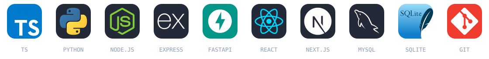

<strong>FULL STACK</strong> &nbsp;•&nbsp; Backend &nbsp;•&nbsp; Automação &nbsp;•&nbsp; IA aplicada

Construo aplicações que conectam **documentos, processos industriais e dados**. Meu foco está no backend e nas integrações: entender a operação, implementar a solução e validar seu comportamento.

### ⚡ Stack em uso

### 🧩 Projetos em destaque

<table>
<tr>
<td width="50%" valign="top">
<h3> NFreader</h3>

Leitura fiscal com IA e saída estruturada em Excel.

<code>Python</code> <code>FastAPI</code> <code>Next.js</code>

Validação para implantação
</td>
<td width="50%" valign="top">
<h3> SIGO · Sistema Integrado de Gestão Operacional</h3>

Formulários e histórico operacional para a indústria.

<code>Next.js</code> <code>Power Apps</code>

Piloto em desenvolvimento
</td>
</tr>
<tr>
<td width="50%" valign="top">
<h3> ZDALL</h3>

IA local para consulta a manuais de manutenção.

<code>Node.js</code> <code>SQLite</code> <code>Ollama</code>

Responsável pelo backend
</td>
<td width="50%" valign="top">
<h3> PeanuTec V2</h3>

Aplicação agro: autenticação, integrações e validação.

<code>Next.js</code> <code>Prisma</code> <code>FastAPI</code>

Manutenção e evolução técnica
</td>
</tr>
<tr>
<td colspan="2" valign="top">
<h3> MARS · SENAI Desafio de Ideias 2026</h3>

<strong>Projeto da equipe vencedora.</strong> MVP para simplificar requisições de materiais no almoxarifado. Atuei como Scrum Master e integrante do backend.

<code>Next.js</code> <code>Node.js</code> <code>MySQL</code>

</td>
</tr>
</table>

### 🧭 O que quero aprofundar

**Segurança cibernética · Redes e infraestrutura · Automação industrial**

Entender o processo. Construir a solução. Validar na prática.

