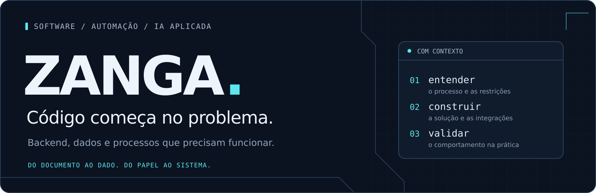

**Desenvolvedor full stack · foco em backend, automação e IA aplicada**

Sou **Zanga**, programador e estudante. Minha formação inclui o ensino médio integrado ao técnico. Trabalho com aplicações web, APIs e dados, conectando o que acontece na operação ao que precisa acontecer no sistema.

Meu ponto de partida costuma ser um documento difícil de interpretar, um formulário que ainda vive no papel ou uma tarefa que alguém precisa repetir todos os dias. A partir daí, investigo o processo, estruturo a solução e trabalho na implementação, nas integrações e na validação.

**O problema primeiro. O código com contexto.**

---

## 01 / Projetos com contexto

### NFreader · documentos fiscais → dados estruturados

Leitura de NF-e e NFS-e, extração de informações e associação a códigos de cadastros internos, com exportação para Excel. O desafio está nos layouts diferentes, nos documentos digitalizados e nos detalhes que precisam chegar corretamente à planilha.

O projeto começou com OCR e evoluiu para extração assistida por IA. Trabalho em regras de negócio, processamento de PDFs e ZIPs, filas com retentativas e preservação de informações como a representação original das quantidades.

`Python` `FastAPI` `Next.js` `Excel` `Processamento de documentos`

**Etapa:** validação para implantação.

### SIGO · registros em papel → histórico operacional

Sistema Integrado de Gestão Operacional, com foco inicial nos registros da caldeira. A proposta conecta formulários, turnos, responsáveis e histórico, para tornar o preenchimento e a consulta mais organizados.

Trabalho com levantamento de requisitos, modelagem de dados, identificação por matrícula e PIN, perfis de acesso e indicadores. O desenvolvimento inclui protótipos web e trabalho com Power Apps; o piloto concentra-se na análise de água do abrandador.

`Next.js` `Power Apps` `Modelagem de dados` `Controle de acesso`

**Etapa:** desenvolvimento do piloto.

### SmartPick · requisição de materiais → fluxo mais simples

Projeto desenvolvido para o **SENAI Desafio de Ideias 2026**, no contexto da MIM Marcon. A solução propõe um catálogo visual de materiais e um fluxo mais intuitivo para solicitar, acompanhar e separar itens no almoxarifado.

Atuei como **Scrum Master e integrante do backend**, em uma equipe de cinco pessoas. O trabalho envolveu organizar entregas, construir o MVP e demonstrar o fluxo com identificação simulada.

`Next.js` `Node.js` `MySQL` `Prototipação` `Scrum`

**Conquista:** projeto da equipe vencedora do desafio. **Escopo:** proposta e MVP demonstrativo.

### PeanuTec V2 · aplicação agro → integração e validação

Trabalho técnico em uma aplicação voltada ao agro, envolvendo organização dos serviços de inteligência, autenticação e autorização, investigação de falhas e testes de comportamento.

Entre os cenários trabalhados estão sessões e permissões, cache meteorológico, solicitações simultâneas e tratamento de falhas em integrações. Esse projeto reúne manutenção de software, dados e validação entre componentes.

`TypeScript` `Next.js` `Prisma` `SQLite` `Python` `FastAPI`

**Frente de atuação:** manutenção, evolução e validação técnica.

### ZDALL · manuais técnicos → consulta assistida

Assistente para apoiar a manutenção com consulta a documentação técnica e IA local. O projeto busca facilitar o acesso ao conhecimento dos manuais e manter o processamento em uma infraestrutura controlada.

Sou responsável pelo **backend**, em colaboração com o desenvolvimento do frontend. Trabalho na API, na persistência do histórico, na recuperação de conteúdo dos documentos e na integração com modelos locais, considerando as limitações de hardware e de execução do ambiente.

`Node.js` `Express` `SQLite` `Next.js` `Ollama` `RAG`

**Etapa:** desenvolvimento e testes de execução.

<strong>Outras frentes de desenvolvimento</strong>

- **EatlyDelivery:** backend para delivery com múltiplos estabelecimentos, autenticação, permissões e dados relacionais, usando Node.js, Express, TypeScript, MySQL e JWT.
- **Gerenciamento de ferramentas:** proposta de sistema com perfis operacionais e administrativos, identificação por RFID e organização de empréstimos por setor.
- **Automações de comunicação:** experimentação com WhatsApp, Teams e integrações entre mensagens, formulários e registros, utilizando Node.js, `whatsapp-web.js` e Power Automate.

---

## 02 / Ferramentas, com propósito

Tecnologias com as quais tive contato prático em projetos. A profundidade varia conforme o problema e o trabalho realizado.

| Camada | Tecnologias e práticas |
| :--- | :--- |
| **Linguagens** | JavaScript · TypeScript · Python · SQL |
| **Aplicações e APIs** | Node.js · Express · FastAPI · React · Next.js · REST |
| **Dados** | MySQL · SQLite · Prisma · Excel · openpyxl |
| **Documentos e IA** | Tesseract · OpenCV · Pillow · extração assistida por IA · Ollama · RAG |
| **Integração e validação** | Git · GitHub · testes automatizados · depuração · Power Apps · Power Automate |

## 03 / Como conduzo o trabalho

**Entender o processo.** Conversar sobre quem usa, o que precisa registrar e onde o fluxo falha.

**Construir com as restrições reais.** Escolher arquitetura, persistência e integrações considerando o ambiente, o orçamento e a infraestrutura disponível.

**Validar o comportamento.** Verificar cenários de erro, permissões, dados inconsistentes e integrações que podem falhar.

**Preparar a continuidade.** Organizar documentação, execução e histórico para que o projeto possa ser retomado, corrigido e ampliado.

## 04 / Próximas conexões

Quero aprofundar meus conhecimentos em **segurança cibernética, redes e infraestrutura**, além de explorar a ligação entre software, **mecatrônica e automação industrial**. São áreas que ampliam minha compreensão de onde e como uma aplicação funciona.

Também exercito comunicação e responsabilidade como **Orador na Ordem DeMolay**. Fora do código, gosto de RPG de mesa, construção de narrativas de terror e mistério e de resgatar eletrônicos antigos.

---

**Vamos trocar ideias sobre backend, automação, IA aplicada e sistemas que precisam funcionar na prática.**
